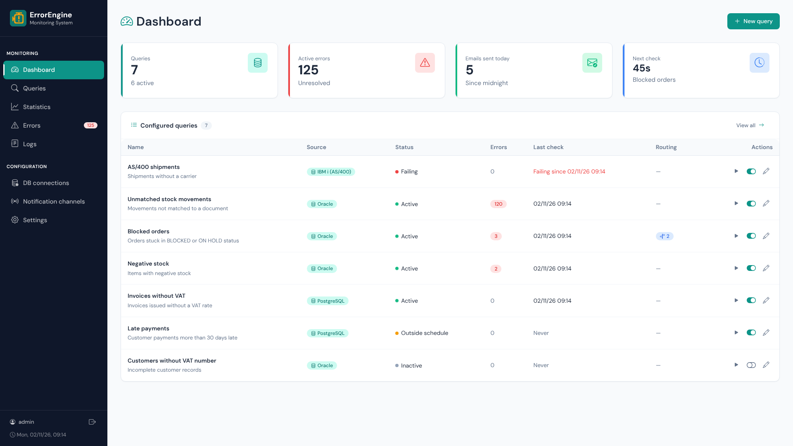
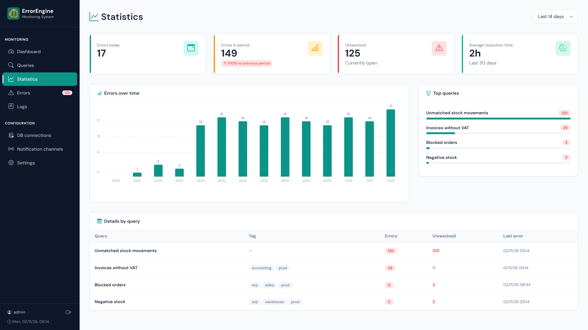
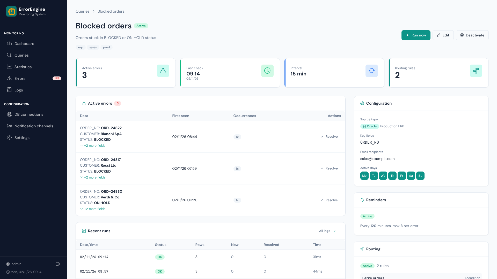

# ErrorEngine

[](https://www.python.org/downloads/)
[](https://flask.palletsprojects.com/)
[](https://opensource.org/licenses/MIT)

A lightweight, self-hosted error monitor for databases and APIs.  
You write a query that returns the problems: ErrorEngine runs it on a schedule and tells the right people when new rows appear. No agents to install.



---

## Features

- **Databases and APIs** — Oracle, PostgreSQL, MySQL/MariaDB, SQL Server, SQLite, IBM i (AS/400), HTTP/JSON sources
- **Notifications** — Email (any SMTP server or Microsoft 365), webhook, Telegram, Microsoft Teams; reminders while an error stays open
- **Conditional routing** — Different recipients depending on the content of each error
- **Scheduling** — Intervals, time windows, days of the week
- **Reliable delivery** — Failed notifications are retried; an alert when a query cannot read its source; health check for external monitors
- **Self-hosted** — Single-user login, works without Internet access, your data stays on your server

---

## Quick start

**Requirements:** Python 3.11 to 3.13. IBM i also needs Java, see [IBM i driver](docs/ibmi-driver.md).

```bash
git clone https://github.com/mpescimoro/ErrorEngine.git
cd ErrorEngine
cp .env.example .env        # Windows: copy .env.example .env
```

1. Start it once, so it creates the virtual environment and installs the dependencies: `start.bat` on Windows, `bash start.sh` on Linux/macOS. Then stop it with Ctrl+C.
2. Generate a secret key and the hash of your password (on Windows use `venv\Scripts\python.exe`):

   ```bash
   venv/bin/python -c "import secrets; print(secrets.token_hex(32))"
   venv/bin/python -c "import getpass; from werkzeug.security import generate_password_hash as h; print(h(getpass.getpass('Password: ')))"
   ```

3. Put them in `.env` as `SECRET_KEY` and `ERRORENGINE_PASSWORD_HASH`, together with your email settings: an SMTP server, Microsoft 365, or nothing to notify only through channels (see [Email](docs/configuration.md#email)).
4. Start it again and open **http://localhost:5000**. The user is `admin`.

The start scripts run `serve.py`, the production server. Windows service, log file and every setting: see [Configuration](docs/configuration.md).

---

## Screenshots

| Dashboard | Statistics | Query detail |
|-----------|------------|--------------|
|  |  |  |

---

## Documentation

|   |   |
|---|---|
| [Getting started](docs/getting-started.md) | Your first monitor, step by step |
| [Configuration](docs/configuration.md) | Settings, sign-in, drivers, production server, backup |
| [Routing rules](docs/routing-rules.md) | Different recipients depending on the error, 15 operators |
| [API](docs/api-reference.md) | REST endpoints for scripts and external monitors |
| [Email templates](docs/templates.md) | Custom notification emails |
| [IBM i driver](docs/ibmi-driver.md) | AS/400 through JT400 |
| [FAQ](docs/faq.md) | Common questions and troubleshooting |

---

## Changelog & Roadmap

See [CHANGELOG.md](CHANGELOG.md) for version history and [ROADMAP.md](ROADMAP.md) for planned work.

---

MIT License — [mpescimoro](https://github.com/mpescimoro) — `<°))><`
